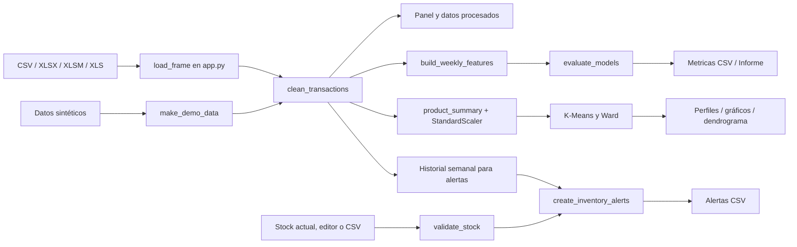

# Documentación técnica de StockSmart ML

## 1. Descripción del sistema

StockSmart ML es una aplicación local de Streamlit que recibe transacciones comerciales, las depura y ofrece seis vistas: resumen, calidad/carga, clasificación de demanda, clustering, alertas y reporte. El procesamiento es en memoria; las únicas salidas persistentes que el usuario obtiene son las descargas que solicita. No hay API, base de datos ni servicio remoto configurado.

## 2. Requisitos y estado de versiones

### Requisitos declarados

- Windows 10 u 11 de 64 bits.
- Python 3.12 de 64 bits disponible mediante `py -3.12`.
- Conexión a Internet para instalar paquetes.
- Espacio y memoria suficientes para cargar y transformar el archivo. El proyecto no define un mínimo de RAM/CPU; el clustering jerárquico puede ser costoso con muchos productos.

`requirements.txt` fija las dependencias directas a las versiones probadas en el entorno de Python 3.12.10:

| Paquete | Versión fijada |
|---|---|
| streamlit | `1.66.0` |
| pillow | `12.0.0` |
| pandas | `2.3.3` |
| numpy | `2.2.6` |
| scikit-learn | `1.7.0` |
| scipy | `1.15.3` |
| matplotlib | `3.10.3` |
| openpyxl | `3.1.5` |
| xlrd | `2.0.2` |
| pytest | `8.4.2` |

Pillow 12.0.0 satisface los metadatos de Streamlit 1.66 (`pillow<13,>=9.2.0`). `joblib` se instala como dependencia transitiva de scikit-learn, no se declara directamente; pytest es requerido para ejecutar la suite. Las dependencias transitivas no están congeladas con lockfile ni hashes.

### Versiones observadas y validez

La primera inspección del entorno encontró Python 3.14.2 y conflictos de dependencias. El `.venv` actual informa Python 3.12.10 y las versiones fijadas arriba; `pip check` y la suite completa se ejecutaron en ese entorno. Las versiones directas coinciden con `requirements.txt`, aunque no existe lockfile para fijar transitivas.

## 3. Arquitectura y flujo de datos



La aplicación establece configuración de Streamlit, carga el origen elegido, limpia transacciones y enruta a una vista según radios del sidebar. La limpieza se aplica antes del panel, la clasificación, la segmentación y las alertas. Las operaciones de lectura, limpieza, features, evaluación y segmentación usan decoradores `st.cache_data` con argumentos como clave.

La subida se lee como bytes en memoria. `load_frame` usa `BytesIO`; no crea copias del archivo en disco. Los botones de descarga reciben bytes/texto generados en la sesión. `st.session_state` conserva el último resultado de modelos relacionado con la clave de dataset; el estado desaparece al finalizar la sesión.

## 4. Estructura de carpetas

```text
StockSmart-ML/
├── app.py
├── requirements.txt
├── setup_windows.bat
├── README.md
├── data/
│   └── README.md
├── models/
│   └── .gitkeep
├── src/
│   ├── __init__.py
│   ├── preprocessing.py
│   ├── features.py
│   ├── classification.py
│   ├── clustering.py
│   └── inventory_alerts.py
├── tests/
│   ├── test_preprocessing.py
│   ├── test_features.py
│   ├── test_classification.py
│   ├── test_clustering.py
│   ├── test_inventory_alerts.py
│   └── test_app.py
└── docs/
    ├── INFORME_ACADEMICO.md
    ├── DOCUMENTACION_TECNICA.md
    ├── METODOLOGIA_MACHINE_LEARNING.md
    ├── MANUAL_USUARIO.md
    └── GUIA_EXPOSICION.md
```

No se encontraron notebooks ni un dataset de ventas dentro del árbol auditado. `data/README.md` explica la fuente opcional y la demo; `.gitignore` excluye datasets tabulares en `data/`, el entorno virtual y los modelos excepto `.gitkeep`.

## 5. Responsabilidad de archivos y funciones

| Archivo | Responsabilidad y entradas/salidas principales |
|---|---|
| `app.py` | Interfaz y orquestación. `load_frame(file_bytes, filename)` retorna DataFrame para CSV/Excel; `show_*_page` renderiza cada sección. Funciones `cached_*` decoran procesamiento, features, evaluación y clustering. |
| `src/preprocessing.py` | `validate_columns(data)` valida esquema mínimo; `clean_transactions(data)` retorna `(DataFrame limpio, CleaningReport)`; `make_demo_data(seed=42)` genera una tabla sintética determinista. |
| `src/features.py` | `build_weekly_features(data, low_quantile=.33, high_quantile=.67)` retorna features/etiquetas y límites descriptivos globales. |
| `src/classification.py` | `evaluate_models(features, test_fraction=.2, low_quantile=.33, high_quantile=.67)` retorna métricas, predicciones, matrices, split, advertencias y estimadores del ajuste. |
| `src/clustering.py` | `product_summary(data)` devuelve una fila por producto; `segment_products(data, n_clusters=3, random_state=42)` devuelve grupos, perfiles, datos escalados, métricas y linkage; `draw_dendrogram(result, max_leaves=30, ax=None)` dibuja el árbol. |
| `src/inventory_alerts.py` | `validate_stock(stock)` verifica códigos/cantidades; `create_inventory_alerts(sales, stock)` retorna tabla de alertas; `alerts_to_csv(alerts)` serializa a bytes UTF-8 con BOM. |
| `requirements.txt` | Versiones fijadas de dependencias directas; no congela las transitivas. |
| `setup_windows.bat` | Comprueba `py -3.12`, solicita confirmación si el `.venv` existente no es 3.12, instala requisitos y comprueba `pip check` e imports. No instala Python. |
| `tests/` | Pruebas unitarias y pruebas de interfaz con `streamlit.testing.v1.AppTest`. |
| `data/README.md` | Describe el dataset de entrada y la demo. Tiene una discrepancia de esquema: dice que `UnitPrice` no es necesaria para cargar, aunque la aplicación la exige. |
| `models/.gitkeep` | Mantiene la carpeta vacía. No se guardan modelos entrenados en ella. |

## 6. Instalación y ejecución en Windows

### Instalación recomendada con CMD

Desde la carpeta del repositorio, abrir CMD y ejecutar:

```bat
setup_windows.bat
```

El script comprueba que se pueda ejecutar Python 3.12 por medio de `py -3.12`. Si no se encuentra, muestra el enlace oficial de Python 3.12.10 y sale; no instala el runtime. Si existe un `.venv` que no ejecuta Python 3.12, muestra una confirmación Y/N. Responder N cancela sin borrar; Y elimina únicamente `.venv` y crea el entorno. Si el usuario no desea reemplazarlo, debe cancelar y conservarlo hasta decidir una alternativa.

El instalador actualiza pip dentro del venv, instala `requirements.txt`, ejecuta `pip check` y prueba imports base (incluidos Streamlit, pandas, NumPy, scikit-learn, SciPy, Matplotlib, motores Excel y `MLPClassifier`). Si cualquiera falla, detiene el flujo con código distinto de cero. Al terminar, la app se inicia así:

```bat
.venv\Scripts\python.exe -m streamlit run app.py
```

Para instalación manual, los comandos están en [README.md](../README.md). Los comandos manuales deben ejecutarse en CMD y referenciar el Python de `.venv`; no se recomienda mezclar `pip` de otro intérprete.

### Instalador

La secuencia de `setup_windows.bat` fue inspeccionada, pero no se ejecutó durante esta publicación porque comprueba el launcher del sistema y puede pedir confirmación para reemplazar `.venv`. La instalación activa se verificó directamente con el Python 3.12.10 de `.venv`; no se afirma que el archivo `.bat` haya sido ejecutado.

## 7. Archivos de entrada

La interfaz acepta `.csv`, `.xlsx`, `.xlsm` y `.xls`. El nombre de extensión decide el motor. Esquema mínimo real:

| Columna | Uso | Requerida |
|---|---|---|
| `InvoiceDate` | Fecha/hora para agrupar por semana. | Sí |
| `StockCode` | Identificador de producto; se trata como texto. | Sí |
| `Quantity` | Unidades por transacción. | Sí |
| `UnitPrice` | Ingreso por línea y feature de clustering. | Sí |
| `InvoiceNo` | Identifica posibles cancelaciones con prefijo C; orders únicas en clustering. | No |
| `Description`, `CustomerID`, `Country` | Se conservan al cargar/limpiar, pero no entran a los clasificadores ni al clustering. | No |

El CSV se intenta leer con `utf-8-sig`, con fallback a `latin-1` solo si hay `UnicodeDecodeError`. En CSV/Excel se solicita `StockCode` como texto para preservar códigos tipo `0007`. No hay validación automática de equivalencias de nombres ni reconocimiento de moneda. La información de fecha debe revisarse si el archivo tiene formatos ambiguos.

Stock actual se importa por separado solo como CSV con columnas `StockCode` y `Stock`; también puede completarse en el `st.data_editor`. El editor usa cantidad mínima cero y paso visual de uno. La validación de servicio exige valores numéricos finitos, no negativos, códigos no vacíos y sin duplicados; no exige que los valores sean enteros.

## 8. Módulos de interfaz

1. **Panel principal:** origen del archivo/demo, ingresos acumulados, unidades, número de productos, filas válidas e ingresos por semana; agrega conteos de limpieza.
2. **Carga de datos:** muestra primeras 30 filas originales, reporte de faltantes y controles de limpieza, y permite bajar ventas procesadas CSV.
3. **Modelos de demanda:** slider de percentiles, mensaje de suficientes datos, métricas ordenadas por F1 macro, matriz de confusión elegible y descarga CSV. Expone fechas/filas de la partición y advierte que la selección es de una sola ventana.
4. **Clustering:** slider para K entre 2 y `min(8, n_productos-1)`, gráficos unidades/ingresos, perfiles originales, silhouette y dendrograma Ward. Requiere tres productos; la función también comprueba perfiles distintos suficientes.
5. **Alertas de inventario:** descarga plantilla, carga CSV de stock o edición, tabla de estimación/estado/método y exportación CSV. Campos vacíos no se interpretan como cero.
6. **Informe:** resume origen y cantidad de filas/productos, muestra resultados de clasificadores solo si fueron calculados para el mismo dataset de la sesión, y presenta limitaciones.

Los gráficos de clustering muestran ejes de unidades e ingresos en escala original, aunque la asignación usa las seis variables escaladas. El dendrograma se trunca a 30 hojas cuando el catálogo es mayor; el ajuste jerárquico utiliza todos los productos.

## 9. Entrenamiento, evaluación y resultados

El entrenamiento no se guarda en disco. Al entrar en Modelos de demanda, `evaluate_models` entrena KNN, Árbol y MLP. Los parámetros se especifican en [Metodología de Machine Learning](METODOLOGIA_MACHINE_LEARNING.md). El informe en sesión y CSV reflejan esa partición, no una garantía de resultado futuro.

No hay función de carga de modelos ni de inferencia posterior a reiniciar la app. La estructura `models/` no contiene artefactos serializados.

## 10. Exportación

- Ventas limpiadas: `ventas_procesadas.csv` desde Carga de datos.
- Métricas de modelos: `metricas_modelos.csv` desde Modelos o Informe.
- Plantilla de stock: `plantilla_stock_actual.csv` desde Alertas.
- Alertas: `alertas_inventario.csv` desde Alertas.

La interfaz codifica descargas CSV en UTF-8 con BOM (métricas/ventas usando `utf-8-sig`; alertas mediante `alerts_to_csv`). Las descargas se generan al pedirlas y no se escriben al repositorio.

## 11. Pruebas automatizadas

Comandos para ejecutar desde CMD después de la instalación:

```bat
.venv\Scripts\python.exe -m pytest -q
.venv\Scripts\python.exe -m compileall -q app.py src tests
.venv\Scripts\python.exe -m pip check
```

Los tests cubren controles de limpieza, ventanas sin fuga, split cronológico y umbrales de entrenamiento, matrices/métricas, resumen/clustering/silhouette/dendrograma, validación y CSV de alertas, demo y cargas de CSV/XLSX en Streamlit.

Resultado ejecutado con Python 3.12.10: **31 passed, 14 warnings** en 18.23 segundos. Las advertencias corresponden a deprecaciones de Matplotlib/pyparsing. `pip check` indicó `No broken requirements found`; `compileall` terminó sin errores. La suite incluye pruebas unitarias y cinco recorridos de interfaz con AppTest, incluyendo CSV y XLSX.

## 12. Errores frecuentes

| Síntoma | Revisión/acción compatible con el proyecto |
|---|---|
| No existe `py -3.12` | Instalar Python 3.12.10 desde el enlace oficial indicado en README y habilitar el launcher. El script no instala Python. |
| `pip check` informa `pillow<13` | Instalar usando `.venv\Scripts\python.exe -m pip` y conservar `pillow<13` declarado; no mezclar con paquetes globales. |
| Un `.venv` está creado con 3.14/3.15 | No borrarlo sin decisión. El script pide confirmación antes de reemplazar exclusivamente `.venv`. |
| Falta una columna | Confirmar nombres exactos y presencia de `InvoiceDate`, `StockCode`, `Quantity`, `UnitPrice`; no se renombran alias automáticamente. |
| Excel `.xls` no se abre | Confirmar instalación de `xlrd`; `.xlsx`/`.xlsm` usan openpyxl. |
| Modelos dicen datos insuficientes | Revisar semanas únicas, variación de demanda y presencia de al menos dos clases en entrenamiento. |
| Clustering no se ejecuta | Se requieren al menos tres productos y perfiles estandarizados distintos suficientes para K. |
| Alerta sin datos suficientes | El SKU debe abarcar cuatro semanas calendario desde su primera semana hasta el final de la serie disponible; código no reconocido queda sin estimación. |
| Aplicación falla al dibujar gráficos | Revisar `pip check` e instalar en venv limpio; fallos de extensiones nativas en un venv incompatible no se corrigen importando con el Python global. |

## 13. Reproducibilidad y limitaciones técnicas

La demo usa generador NumPy con `seed=42` y fechas fijas; su contenido es reproducible bajo versiones compatibles, aunque versiones numéricas pueden cambiar implementaciones. Árbol, MLP y K-Means fijan `random_state=42`; KNN no es aleatorio. Los cuantiles son 0.33/0.67 por defecto, la partición de clasificación es 20% de las semanas únicas más recientes y el UI permite modificar percentiles, no la fracción de prueba.

La muestra de UCI no está presente, no hay archivo de dependencias bloqueado y no hay un registro de versiones resueltas en Python 3.12. Para un informe reproducible se recomienda registrar el hash/periodo del archivo real, versiones exactas resueltas (`pip freeze`), parámetros elegidos, corte temporal y CSV de resultados. Ninguno de esos pasos equivale a probar validez externa; para ello se requieren datos adicionales y diseño experimental.
