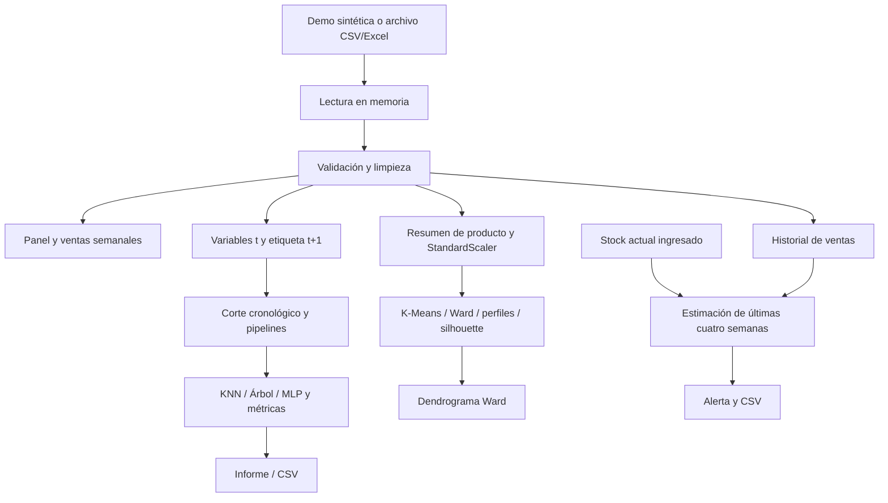

# StockSmart ML: análisis de ventas, clasificación de demanda y alertas orientativas de inventario

## Portada

| Campo | Completar |
|---|---|
| Estudiante | [Nombre del estudiante] |
| Curso | [Nombre del curso] |
| Docente | [Nombre del docente] |
| Institución | [Nombre de la institución] |
| Fecha | [Ciudad, día, mes y año] |

> **Nota de rigor:** este informe describe el código que existe en el repositorio. El dataset de UCI no está incluido; la aplicación ofrece datos sintéticos solo para demostración. No se presentan métricas de un estudio sobre datos reales.

## Resumen

StockSmart ML es una aplicación académica desarrollada en Python y Streamlit para inspeccionar transacciones comerciales, construir variables semanales, comparar clasificadores de demanda, agrupar productos y contrastar una estimación sencilla de ventas con el stock actual ingresado por el usuario. El flujo de clasificación emplea K-Nearest Neighbors (KNN), Árbol de Decisión y perceptrón multicapa (MLP) de scikit-learn. Para segmentación aplica K-Means y agrupamiento jerárquico Ward sobre variables de producto estandarizadas. Las alertas usan la media de las últimas cuatro semanas calendario disponibles.

La carga admite CSV, XLSX, XLSM y XLS con las columnas `InvoiceDate`, `StockCode`, `Quantity` y `UnitPrice`; `InvoiceNo` es opcional y ayuda a reconocer cancelaciones. La limpieza excluye ventas no positivas, precios negativos, cancelaciones identificables y registros inválidos o duplicados. La interfaz distingue la demo sintética de los archivos aportados por el usuario y permite descargar tablas como CSV.

La implementación cuenta con pruebas unitarias y de interfaz. En la ejecución verificada con Python 3.12.10, se obtuvieron 31 pruebas aprobadas y 14 advertencias deprecadas de Matplotlib/pyparsing; `pip check` no encontró dependencias rotas. El instalador por lotes no se ejecutó en esta revisión. No se dispone de resultados experimentales sobre un archivo de ventas real.

**Palabras clave:** demanda, clasificación, series temporales, inventario, clustering, Streamlit.

## 1. Introducción

Las ventas registradas permiten resumir la actividad comercial y estudiar patrones de demanda por producto. Sin embargo, un historial de transacciones no equivale necesariamente a la demanda completa: una venta baja también puede deberse a falta de existencias. Para apoyar la exploración, StockSmart ML reúne herramientas sencillas de limpieza, clasificación y segmentación, junto con alertas orientativas basadas en una estimación reciente.

El sistema es un prototipo académico y no un sistema de planificación de recursos empresariales. No conecta con puntos de venta, proveedores ni inventarios históricos. Su utilidad principal es mostrar un flujo reproducible de preparación de datos y análisis, dejando visibles sus supuestos y límites.

## 2. Planteamiento del problema

### 2.1 Situación problemática

Los archivos transaccionales pueden contener cancelaciones, devoluciones, campos inválidos, códigos de producto interpretados como números y semanas sin registros. Analizarlos sin preparación puede distorsionar totales y comparaciones. Además, el usuario que desea revisar productos con posibles necesidades de reposición debe aportar por separado el stock actual, pues el historial de ventas no lo contiene.

### 2.2 Pregunta general

¿Cómo puede una aplicación reproducible organizar un archivo histórico de ventas para explorar categorías de demanda, similitudes entre productos y alertas orientativas, evitando utilizar información futura al construir los predictores semanales?

Esta pregunta enmarca el desarrollo del prototipo. El proyecto no demuestra que la aplicación mejore decisiones o resultados financieros de una empresa.

### 2.3 Objetivo general

Desarrollar una aplicación académica que prepare transacciones de venta, compare clasificadores de demanda semanal, segmente productos mediante dos métodos de clustering y genere alertas orientativas al recibir el stock actual.

### 2.4 Objetivos específicos

1. Validar las columnas mínimas y depurar transacciones inválidas, cancelaciones y cantidades no positivas.
2. Agregar la demanda por producto y semana y crear rezagos y estadísticas móviles observadas antes de la semana objetivo.
3. Comparar KNN, Árbol de Decisión y MLP en una partición cronológica con métricas de clasificación.
4. Segmentar perfiles de producto escalados con K-Means y Ward, mostrando grupos, perfiles, silhouette y dendrograma.
5. Contrastar demanda reciente estimada con stock actual ingresado, explicando la insuficiencia de historial y permitiendo exportar resultados.
6. Integrar los componentes en una interfaz Streamlit en español.

## 3. Justificación

### 3.1 Práctica

El prototipo agrupa pasos que suelen ejecutarse por separado: inspección del archivo, limpieza, análisis semanal, comparación de clasificadores y revisión de stock. Las descargas CSV facilitan revisar los resultados fuera de la interfaz. No automatiza compras ni sustituye la revisión del responsable de inventario.

### 3.2 Tecnológica

El proyecto usa Python, Pandas, NumPy, scikit-learn, SciPy, Matplotlib y Streamlit. Los pipelines del clasificador mantienen el ajuste del escalado y de la codificación en los datos de entrenamiento. El procesamiento de archivos subidos ocurre en memoria durante la sesión.

### 3.3 Académica

Permite ilustrar preparación temporal, aprendizaje supervisado, clustering, métricas y comunicación de limitaciones en una aplicación ejecutable. La demo sintética sirve para recorrer la interfaz, no para sustentar conclusiones sobre una empresa o el dataset de UCI.

## 4. Alcance y limitaciones

El alcance implementado comprende carga y limpieza de transacciones, panel de resumen, evaluación de tres clasificadores, dos métodos de segmentación, importación o edición del stock y exportación CSV. Los análisis toman los datos presentes en la sesión. No existe base de datos, autenticación, persistencia de stock, entrenamiento en segundo plano ni integración con proveedores.

Las limitaciones principales son:

- El dataset Online Retail de UCI no está almacenado en el repositorio. La auditoría del contenido del archivo real queda pendiente hasta que se cargue uno.
- Las ventas observadas pueden subestimar la demanda cuando hubo quiebre de stock.
- La clasificación utiliza clases relativas definidas por cuantiles y un solo corte temporal, no validación temporal repetida.
- La alerta es una media de cuatro semanas calendario, sin estacionalidad, plazo de entrega, pedidos en tránsito, stock reservado ni reglas de compra.
- La semana más reciente se considera observada; si está incompleta, la media puede reducirse artificialmente.
- K es escogido manualmente por el usuario; no hay búsqueda automática del número óptimo de grupos.
- El clustering jerárquico puede requerir memoria y tiempo considerables en catálogos amplios.
- No hay guardado ni carga de modelos entrenados.
- El paquete de dependencias usa rangos, no un archivo de bloqueo completo. El entorno de prueba observado no coincide con el Python 3.12 objetivo.

## 5. Marco teórico

### 5.1 Aprendizaje supervisado y clasificación

En aprendizaje supervisado, un algoritmo aprende una función que relaciona predictores con una etiqueta observada. StockSmart ML convierte demanda semanal futura en tres categorías —Baja, Media y Alta— definidas mediante cuantiles de la demanda. Por ello, la salida es una clase, no una predicción numérica de unidades.

### 5.2 Series temporales y fuga de información

En datos temporales, la observación usada para predecir un periodo debe contener solo información disponible antes de ese objetivo. En el código, una fila de referencia temporal `t` usa demanda semanal hasta `t`; la etiqueta `Demand` de esa fila es la demanda de `t+1`. La evaluación reserva semanas cronológicamente posteriores. Las semanas únicas se mantienen enteras a un solo lado de la partición.

### 5.3 Clustering

El clustering agrupa observaciones sin una etiqueta objetivo suministrada. K-Means busca particiones compactas alrededor de centroides; Ward aglomera grupos minimizando aumentos de variación interna. En ambos casos, las seis medidas de producto se estandarizan antes del ajuste. Los identificadores de grupo son arbitrarios y no constituyen segmentos comerciales validados.

### 5.4 Métricas

Accuracy es la proporción total de predicciones correctas. Precision mide la proporción de predicciones de una clase que son correctas; recall, la proporción de elementos reales de esa clase que se recuperan; F1 combina precision y recall mediante media armónica. El código muestra promedios macro y valores por clase, y una matriz de confusión. Silhouette resume cohesión y separación relativa de grupos bajo la distancia utilizada; no demuestra que los grupos sean útiles comercialmente.

## 6. Dataset y procedencia

El catálogo [Online Retail de UCI](https://archive.ics.uci.edu/dataset/352/online+retail) describe transacciones de un minorista británico entre diciembre de 2010 y diciembre de 2011; registra 541 909 instancias y seis features en su ficha. La tabla de variables enumera ocho columnas: `InvoiceNo`, `StockCode`, `Description`, `Quantity`, `InvoiceDate`, `UnitPrice`, `CustomerID` y `Country`. La ficha señala que `InvoiceNo` que empieza por C identifica una cancelación y que el precio unitario está expresado en libras esterlinas.

El archivo no se incluye en este repositorio. Por tanto, las cifras de la ficha describen la fuente citada, no un archivo cargado o evaluado en este proyecto. La aplicación requiere cuatro columnas: fecha, código, cantidad y precio unitario. El número de factura es opcional; cliente, descripción y país no se usan en los modelos. StockCode se conserva como texto para proteger ceros iniciales.

La función de carga no incorpora un mapeo automático de nombres alternativos. Para CSV intenta UTF-8 con BOM y, ante error de decodificación, Latin-1. Excel XLSX/XLSM usa openpyxl; XLS usa xlrd. El archivo cargado se procesa en memoria, no se guarda automáticamente en `data/`.

## 7. Metodología de desarrollo

El diseño separa interfaz (`app.py`) de lógica en `src/`. Se sigue un flujo incremental: limpieza; agregación semanal y ventanas; evaluación; agrupamiento; alertas; exposición en Streamlit. Los tests existentes cubren funciones de módulos y recorridos de interfaz con `AppTest`. Esta estructura y la lista de pruebas describen implementación; no prueban aceptación por usuarios o validación empresarial.

## 8. Limpieza y preprocesamiento

`clean_transactions` valida `InvoiceDate`, `StockCode`, `Quantity` y `UnitPrice`, copia el DataFrame, convierte fecha y cantidades, y genera un reporte con filas de entrada/salida, nulos, duplicados, cancelaciones, cantidades negativas e inválidos.

Se consideran inválidas las filas con campos requeridos ausentes/no convertibles, valores de cantidad o precio no finitos, o código de producto vacío. Se excluyen las facturas con prefijo C (si existe `InvoiceNo`), cantidades menores o iguales a cero, precios negativos y duplicados exactos. Se calcula `Revenue = Quantity × UnitPrice`. Las cantidades negativas se cuentan antes de ser excluidas; las devoluciones no se incorporan a la demanda positiva.

## 9. Ingeniería de características

Las ventas positivas se agrupan por `StockCode` y semana calendario de lunes a domingo, representada por su lunes inicial. Dentro del historial de cada producto se insertan ceros en semanas sin ventas. Después de tres semanas iniciales necesarias para tener ventanas completas, cada fila usa:

| Variable | Definición implementada |
|---|---|
| `lag_1` | Demanda de la semana de referencia `t`. |
| `lag_2` | Demanda de `t-1`. |
| `lag_3` | Demanda de `t-2`. |
| `mean_4` | Media de demanda de `t-3` hasta `t`. |
| `std_4` | Desviación estándar muestral de esa ventana de cuatro semanas; NaN inicial se reemplaza por cero. |
| `trend_4` | Diferencia `lag_1 - lag_3`. |
| `Demand` | Etiqueta numérica: demanda de la semana siguiente `t+1`. |

La clase exploratoria se asigna con cuantiles configurables (por defecto 0.33 y 0.67). En la evaluación se recalculan los umbrales solo con Demand del entrenamiento y se reasignan las clases de entrenamiento y prueba con los mismos límites.

## 10. Algoritmos implementados

Los parámetros exactos, variables, métricas y limitaciones se detallan en [Metodología de Machine Learning](METODOLOGIA_MACHINE_LEARNING.md). En síntesis, los modelos supervisados son KNN, DecisionTreeClassifier y MLPClassifier de scikit-learn; los no supervisados son KMeans y AgglomerativeClustering con linkage Ward. No se usa TensorFlow/Keras.

## 11. Arquitectura y aplicación

La interfaz se ejecuta en un único archivo Streamlit y ofrece navegación lateral por panel principal, carga de datos, modelos de demanda, clustering, alertas e informe. El flujo general es:

Las transformaciones repetidas de datos, métricas y clustering usan `st.cache_data`. Las cargas de datos y descargas se ejecutan en memoria en la sesión. No se serializan estimadores a `models/` ni se cargan modelos persistidos.

## 12. Diseño y evaluación experimental

La función `evaluate_models` ordena filas por semana y código, divide las semanas únicas según `test_fraction=0.2` por defecto y entrena con las semanas anteriores. La semana se asigna íntegramente a entrenamiento o prueba. Un `ColumnTransformer` imputa la mediana y estandariza los seis predictores numéricos, y codifica `StockCode` con one-hot; cada transformación se ajusta dentro de un pipeline usando solo entrenamiento. Los códigos desconocidos en prueba se ignoran.

Se reportan accuracy, precision macro, recall macro, F1 macro y precision/recall/F1 por clase. La matriz de confusión fija orden Baja, Media, Alta; los valores indefinidos se tratan como cero. Se destaca el modelo de mayor F1 macro dentro de esa partición. No se realiza validación cruzada temporal, búsqueda de hiperparámetros ni estimación de intervalos de incertidumbre.

Para clustering el código calcula silhouette por cada método cuando existe un número de grupos válido (más de uno y menor que el número de productos). El usuario selecciona K en la interfaz; el sistema no busca K óptimo automáticamente.

## 13. Resultados verificables

### Resultados experimentales sobre ventas

**Pendientes.** No hay dataset de ventas real en el repositorio ni un registro de métricas reproducibles obtenidas con uno. Las métricas que aparezcan al cargar datos son resultados de esa sesión y dependen del archivo y de los percentiles elegidos. La demo usa datos sintéticos con semilla fija 42 y no representa Online Retail.

### Verificación del software disponible

Con Python 3.12.10, pytest dio `31 passed, 14 warnings` (18.23 s), `pip check` indicó `No broken requirements found` y `compileall` terminó sin errores. Las advertencias son deprecaciones Matplotlib/pyparsing. El archivo `setup_windows.bat` no se ejecutó; la suite sí se ejecutó directamente en el `.venv` actual. Este resultado técnico no es una métrica de calidad predictiva.

Para completar resultados académicos se requiere, como mínimo, cargar un archivo real bien documentado, registrar periodo y conteo después de limpieza, guardar parámetros de evaluación, entrenar y evaluar con cortes temporales repetidos o backtesting, reportar matrices/métricas por clase y discutir variabilidad y baselines. Para valorar alertas se requieren existencias históricas y reglas operativas de reposición.

## 14. Discusión

La arquitectura reúne técnicas interpretables para un ejercicio introductorio y hace explícitas algunas precauciones metodológicas: ventanas pasadas, partición cronológica, preprocesamiento ajustado en entrenamiento, clases calculadas con umbrales de entrenamiento, productos escalados y datos insuficientes para alertas. La clasificación es de categorías de demanda; no sustituye un pronóstico de unidades. Los umbrales son relativos a la distribución de entrenamiento y el modelo seleccionado solo lidera una prueba temporal.

El clustering describe similitud según las variables agregadas. Un perfil con más unidades o ingresos no es necesariamente “mejor”, y los números de cluster carecen de orden semántico. Silhouette no considera valor económico ni capacidad de reposición.

La alerta simplifica el inventario al stock actual y una media de cuatro semanas. No considera lead time ni ventas perdidas. A falta de inventario histórico, las ventas pueden estar censuradas por disponibilidad. Por ello, una alerta debe interpretarse como señal para revisión humana, no como recomendación de compra validada.

## 15. Conclusiones vinculadas a los objetivos

1. La validación y limpieza descritas en `src/preprocessing.py` cubren columnas obligatorias, conversiones, exclusiones y reporte de calidad; las pruebas existentes incluyen estos controles.
2. `src/features.py` genera ventanas semanales anteriores a la etiqueta futura. Las pruebas incluyen una comprobación que cambia la semana objetivo y verifica que no altere los predictores de esa fila.
3. `src/classification.py` compara tres clasificadores con un corte cronológico por semanas únicas y métricas macro/por clase. La evidencia disponible no permite concluir cuál generaliza mejor en ventas reales.
4. `src/clustering.py` implementa K-Means y Ward sobre perfiles estandarizados e incluye perfiles, silhouette y dendrograma. K es seleccionado manualmente.
5. `src/inventory_alerts.py` valida stock, calcula media de cuatro semanas y distingue historial insuficiente. La estimación no es un sistema integral de reposición.
6. `app.py` conecta esos componentes en una interfaz en español con importación y descargas. Las pruebas AppTest de la interfaz pasaron en el entorno Python 3.12.10 utilizado.

## 16. Recomendaciones y trabajo futuro

- Repetir la instalación y toda la batería de pruebas en un entorno limpio Python 3.12 de Windows; generar y mantener un lockfile después de decidir una política de actualización.
- Corregir la descripción de columnas en `data/README.md` para que refleje que `UnitPrice` es obligatoria en la aplicación.
- Validar formatos de fecha explícitos y documentar zonas horarias, moneda y codificación esperadas.
- Evaluar con datos reales autorizados, backtesting temporal y modelos base sencillos; conservar un manifiesto del dataset, transformaciones y métricas.
- Considerar regresión/forecasting de unidades si se necesita un pronóstico numérico, con intervalos y evaluación apropiada.
- Incorporar inventario histórico, quiebres, compras en tránsito, plazo de entrega y stock de seguridad antes de emitir propuestas de reposición.
- Evaluar criterios de K en varios valores y revisar estabilidad de grupos; controlar la escalabilidad del clustering jerárquico.
- Añadir persistencia versionada de modelos solo con un diseño explícito de seguridad y compatibilidad.
- Medir usabilidad y validar interpretaciones con usuarios antes de uso operativo.

## Referencias (formato APA 7)

Chen, D., Sain, S. L., & Guo, K. (2012). Data mining for the online retail industry: A case study of RFM model-based customer segmentation using data mining. *Journal of Database Marketing & Customer Strategy Management, 19*(3). [Ficha del artículo en UCI](https://archive.ics.uci.edu/dataset/352/online+retail).

Pandas Development Team. (s. f.). *Time series / date functionality*. Pandas documentation. https://pandas.pydata.org/docs/user_guide/timeseries.html

Scikit-learn developers. (s. f.). *scikit-learn user guide: Preprocessing, model evaluation, and clustering*. https://scikit-learn.org/stable/user_guide.html

Streamlit, Inc. (s. f.). *Streamlit API reference*. https://docs.streamlit.io/develop/api-reference

UCI Machine Learning Repository. (2015). *Online Retail* [Conjunto de datos]. https://archive.ics.uci.edu/dataset/352/online+retail

## Anexos técnicos

### Archivos principales

- `app.py`: interfaz y orquestación.
- `src/preprocessing.py`: validación, limpieza y datos sintéticos.
- `src/features.py`: agregación temporal y variables.
- `src/classification.py`: pipelines, entrenamiento y métricas.
- `src/clustering.py`: resumen de producto, K-Means, Ward y dendrograma.
- `src/inventory_alerts.py`: validación de stock, estimación y CSV.
- `tests/`: pruebas automatizadas de lógica y recorridos de interfaz.

### Datos por completar para una entrega experimental

- Archivo exacto y versión/licencia del dataset realmente utilizado.
- Conteos de filas antes y después de limpieza y periodo cubierto.
- Sistema, versiones de Python y dependencias del entorno que completó las pruebas.
- Métricas exportadas por modelo, clase, fechas de corte y parámetros.
- Resultados de clustering, K seleccionado, perfiles interpretados y gráficos exportados.
- Evidencia de validación de alertas frente a inventario y decisiones reales.
